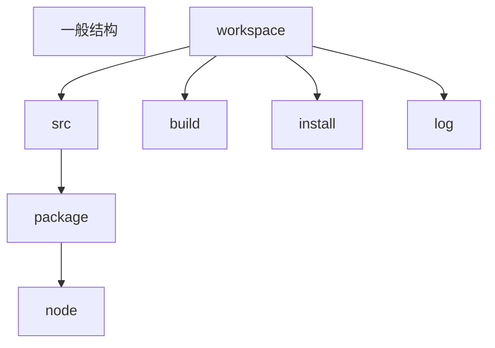
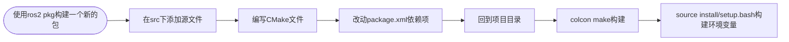
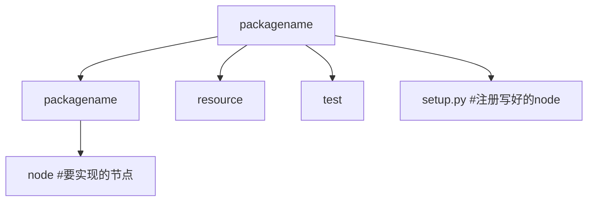

# Ros2 使用 

## 1. 基础认知

*运行小海龟*

~~~
ros2 run turtlesim turtlesim_node
~~~

*键盘控制小海龟*

```
ros2 run turtlesim turtle_teleop_key
```

>  rqt: 此命令可以查看各节点之间的话题通信


## 2.节点（node）

### 2.1 功能包组织节点

**重点知识**

**Workspace（工作空间）**

	- src(代码空间)
	- install（安装空间）
	- build（编译空间）
	- log（日志空间）

每次创建完工作空间后，需要利用`colcon build`编译这个工作区的文件，但如果想要使用这个工作区文件，必须加到环境变量中让系统可以识别，具体操作就是在ws/install下会有一个启动文件`local_setup.sh`文件,用命令`source install/local_setup.sh`添加到系统路径中即可与运行这个工作区文件

> 但是这样,需要每次打开终端都重新加入,如果不想每次都操作,把这个操作加入.bahsrc文件中
>
> echo "source ~/ros2_ws/install/setup.bash" >> ~/.bashrc
>
> 类似这样,这样每次启动新的终端都会自动加载这个工作区里的文件





**功能包**(一般放在工作区的/src下)

1. python创建功能包

```bash
ros2 pkg create --build-type ament_python --license Apache-2.0 demo_python_pkg
```

> ros2 pkg 对应包的命令
>
> create是创建新的功能包
>
> --build-type是选取构建类型（默认是cpp的CMake）
>
> ament_python是要构建的类型
>
> demo_python_pkg是包的名字

创建好包之后，在包的子目录中选取同名的文件夹创建节点,注意不需要main的入口

之后在setup.py中找到entry_point写出入口：'入口名字 = 包名字.节点名字.函数名字'

之后在package.xml里面添加依赖项

最后利用`colcon build`构建文件，会产生三个文件夹（同级），build是中间文件，install是可执行文件，log是生成的日志


cPP流程总结:




### 2.2 创建节点

节点是执行具体任务的进程,是独立运行的可执行文件,通过节点名称进行管理

1. python实例



```python
import rclpy
from rclpy import rclpy.node
    
def main():    
    rclpy.init() # 为通信做初始化工作
    node = Node("pthonnode") # 创建一个节点变量
    node.get_logger().info("woshijun") # 用于获取日志文件 node.get_logger 这个命令后加的是或取得日志的级别,如info, warn等

    node.get_logger().info("woshipython")
    node.get_logger().warn("woshipython")
    rclpy.spin(node) # 运行这个节点
    rclpy.shutdown() # 关闭节点
```

> get_logger() 对应的日志级别 debug < info < warn < error < fatal


**配置节点**:

在setup.py 找到 entry_points这个字典

```python
entry_points={
    'console_scripts': [
        # 格式：'你想用的运行名字 = 包名.文件名:要执行的函数名'
        'my_node = my_py_pkg.my_node:main',
    ],
},
```


2. c++实例

```cpp
#include <iostream>
#include "rclcpp/rclcpp.hpp"


int main(int argc, char ** argv) //第一个参数是参数数量, 第二个是程序的参数,是一个字符串数组

{
    rclcpp::init(argc, argv);
    auto node = std::make_shared<rclcpp::Node>("cpp_node"); //make_shared是创建并且返回一个共享指针,Node
    RCLCPP_INFO(node->get_logger(), "cpp_node"); //返回一个日志
    rclcpp::spin(node); // 循环检测并且运行节点
    rclcpp::shutdown();
    return 0;
/*
*第一步是初始化.
*第二部是创建一个节点.
*第三步是打印日志.
*第四步是让节点运行.
*第五步是关闭节点.
*/
}

```


*cmake*:

使用前需要构建这个build文件夹

`cmake -S . -B build`

> 第一个s后边跟的是源码的文件夹, .就表示当下的文件夹的所有
>
> -B build表示的是构建目录,没有就直接新建

然后就构建

`cmake --build build`

eg.

```cmake
cmake_minimum_required(VERSION 3.11)
project(ros_cpp)


set(CMAKE_CXX_STANDARD 17)
set(CMAKE_CXX_STANDARD_REQUIRED ON)

find_package(rclcpp REQUIRED) # 找依赖项

target_include_directories(ros_cpp PRIVATE include) # 把依赖库头文件连接到可执行文件
target_link_libraries(ros_cpp ${rclcpp_LIBRARIES}) # 把库文件连接


aux_source_directory(src SRC) # a
add_executable(ros_cpp ${SRC}) # 生成可执行文件
```


### 2.3 面向对象编程

一些新的c++特性语法

**自动类型**: `auto`

**智能指针**: 自动释放和新开辟内存空间

创建`std::make_shared<>()` 创建共享指针, 赋值时左值可以用`auto`类型

也可以直接写共享指针类型`shared_ptr`


**Lambda表达式**:本质是一种匿名函数,用于处理一些简单的运算和操作的快捷的函数

​	*格式*: `[capture list](parameters) -> return_type{function};`

​	或者: `[capture list](parameters){function}(传入的参数列表);` 

> 区别在于第一个是指定返回了类型的, 而第二个会自动推导返回类型

> capture是捕获外部变量， parameters是参数列表， 后边的是指定的返回值类型（可省略因为会自动推导）， 最后的是函数体

```cpp
//eg
auto func = [](){return 3;}; //不捕获也不传值
auto func2 = [](int x, int y){return x + y;}; //不捕获但是传参进行运算
int a = 10;
auto func3 = [a](){return a + 1;}; //捕获外部变量
```

> 捕获方式
>
> 1. 值捕获： `auto func = [a]()->{}`, 把外部变量a 按值传递的方式传入函数体内部
> 2. 引用捕获： `auto func = [&a]()->{}`, 把外部变量a的引用传入函数, 可以修改他的值
> 3. 捕获所有变量([=] | [&]): 这两种方式都捕获所有的外部变量, 区别在于第一个是按照值捕获, 而第二个是引用捕获


**函数包装器**：

​	*背景：有三种函数，全局函数， 成员函数， lambda函数，调用时有问题，利用函数包装器统一他们*

### 2.4 多线程与回调函数

1. cpp

需要一个http的请求库函数


## 3. 话题

### 3.1 话题通信


.msg文件定义的消息结构


## 3.2 案例（通过话题发布小说）


