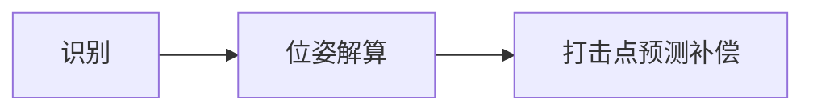

# 自瞄

### 识别

方案一：1.  yolo 检测（只检测装甲板大致位置，提高鲁棒性）--> roi出装甲板区域 --> 传统视觉(opencv) 提供角点位置

(预测缺点: 比较难写,但是精确度高; 传播路径长,推理可能会变慢)

具体实现(暂时想法):

利用网上现有整车实战照片和自己拍摄制作的数据集, 利用最原始的方框标注数据, 目的是提取出来带有装甲板的一小块区域,并且利用yolo可以提高鲁棒性,便于后续的传统视觉处理

至于Yolo,暂时先使用封装好的模型,后续可以通过开源方案和调试时遇到的问题对yolo内部的损失函数等进行修改改, 整体的训练思路是先训练个l级别的大模型,然后蒸馏到nano / small 提高准确率

后续利用opencv对roi区域进行处理: 目标是识别灯条角点位置, 识别颜色, 识别数字

方案二: yolo pose 直接返回角点位置

(缺点: 标注数据复杂,推理一步到位,但是可能有不准确的问题,完全取决于模型的训练程度)

# 位姿

1. 相机标定找好内参
2. 