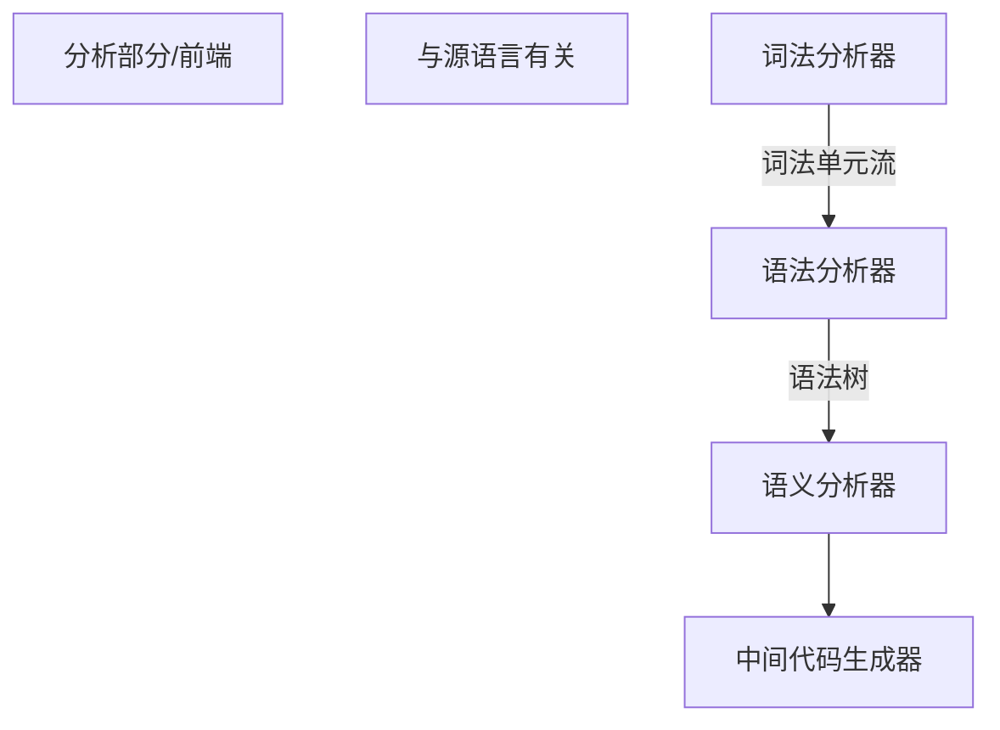

# 编译原理

# 基本原理

1. 语义分析 

2. 语法分析
3. 词法分析



```MERMAID
flowchart TD
R[综合部分/后端]
T[与目标语言有关]
A[目标代码生成器]--目标机器语言-->B[及其相关代码优化器]-->C[目标机器语言]
```

## 词法分析/扫描(scanning)

1. 主要任务:从左到右扫描源程序,识别单词,确定类型,转化为词法单元(token)的格式

**token: <种别码,属性值>**


IDN 表示标识符


## 语法分析(parsing)

1. 主要任务:
   从词法分析的token序列中识别各类短语,构造语法分析树(parse tree)


# 语言与文法

## 文法

### 1. 形式化定义

$G = (V_T, V_N, P, S)$

终结符, 终结符,产生式,开始符号(开始符号必须是一个非终结符)

> 产生式: $\alpha -> \beta$: 叫作a定义为b

**产生式简写**:

对于左部相同的产生式: 
$$
\alpha \to \beta_1, \alpha \to \beta_2, \alpha \to \beta_3......
$$
可以写为:
$$
\alpha \to \beta_1 |\beta_2|\beta_3....
$$
$\beta_1, \beta_2,......$叫作$\alpha$的**候选式**

> 一般说来,排在前面的小写字母表示终结符,大写字母表示非终结符
>
> 排在后边的小写字母表示终结符号串


### 2.分类

1. **0型文法:** $\alpha \to \beta$(无限制文法/短语结构文法)

- $\forall \alpha \to \beta \ \alpha$至少有一个非终结符


2. **1型文法**: 上下文有关文法(CSG)

- $\alpha \to\beta\in P$, $|\alpha|\leq|\beta|$

- 产生式的一般形式:  $\alpha_1 A \alpha_2 \to \alpha_1 \beta\alpha_2(\beta\neq\varepsilon)$

- **注意:不包含空产生式**


3. **2型文法**: 上下文无关文法(CFG)

- $\alpha \to\beta\in P$, $\alpha \in V_N$
- 产生式的一般形式:  $A \to \beta$


4. **3型文法**:正则文法

- 左线性文法
- 右线性文法

*写一个用于生成标志符的左线性文法*


### 3.CFG分析树

分析树用来描述句子结构，是推导的图形化表示

根节点是文法的开始符号，内部节点是对一个产生式的应用，叶子节点既可以是非终结符也可以是终结符，从左到右排列叶节点的符号串称为这个树的产出或者**边缘**


**句型的短语**： 给定一个句型，其分析树中的每一棵子树的边缘称为该句型的一个短语

- 若只有父子两代结点，那么这个子树的边缘成为该句型的一个**直接短语**


**二义性文法**：

一个可以为句子生成多个分析树的文法


## 语言

推导:产生式右部替换左部

归约:推导的逆过程,利用产生式的左部替换右部

$\!!!!$

**句型**:(既可以包含终结符,又可以包含非终结符,也可以是空串)

**句子:** 是一种*不包含非终结符*的**句型**


### 1.形式化定义

有文法G开始符号S推导出的所有句子的集合称为**文法G生成的语言**, 记为$L(G)$

即: 
$$
L(G) = \{\omega|S\Rightarrow^*\omega, \omega \in V_T^*\}
$$
*作业:写出无符号整数和浮点数的文法*


### 2. 语言上的运算

|     并     | $L \or M = \{s|s属于L或者M\}$ |
| :--------: | ----------------------------- |
|    连接    | $LM = \{st|s属于L且t属于M\}$  |
|     幂     |                               |
| Kleene闭包 |                               |
|   正闭包   |                               |
|            |                               |


# 词法分析

## 1.正则表达式

正则表达式是一种用来描述**正则语言**的更紧凑的方法

- 可以用较小的正则表达式递归地构建,每个正则表达式r可以表示 一个语言L(r)

1. 定义:

- $\varepsilon$是一个RE,L($\varepsilon$)=$\varepsilon$

- !!!!


可以用正则表达式表达的语言叫作**正则语言**

对任何正则文法G.存在定义同一语言的正则表达式r(反之成立)


### 2.正则定义

**正则定义**是具有

!!!


### 3.有穷自动机

FA模型

输入带,读头,有穷控制器

表示方式:转换图

结点表示状态太,初始状态只有一个,终止状态可以有多个,用双圈表示


接受的语言: 

- 

所有接受的串构成的集合称为F定义的语言 L(M)


最长子串匹配原则

输入串的多个前缀与一个或者多个模式匹配的时候,选择最长的前缀进行匹配


#### 2.分类

DFA(确定的有穷自动机)

*算法实现*:

 !!!


NFA


### 4.正则表达式到自动机

子集构造法


### 5.识别单词的DFA

。。。。


# 语法分析

### 1. 自顶向下的分析

最左推导和最右推导有唯一性


自顶向下的分析采取最左推导的方式


**通用形式**

**==递归下降分析==**：

- 由一组过程构成，每个过程对应一个非终结符，每个过程通过选择不同的产生式下降,直到有终结符匹配到输入串的字符,然后进行下一个
- 有可能需要回溯

**预测分析：**

是递归下降分析的一个特例，在输入中向前看固定个数（通常是一个）来选择正确的产生式

也成为LL（1）文法

不需要回溯


### 2.文法转换

同终结符的多个候选式存在共同前缀时候,容易出现回溯现象

 

形如$A \to A\alpha$产生式的文法称为==直接左递归文法==

若一个文法中有一个终结符A使得对某个串$\alpha $存在一个推导$A \Rightarrow ^+ A\alpha$,那么这个文法是==左递归==的

经过两步及以上推导产生的左递归称为间接左递归

左递归会陷入无限循环,应该消除


1. 消除左递归

- 消除直接左递归


- 消除间接左递归 

$$
S \to Aa|b 	
\\
A \to Ac|Sd|\varepsilon
$$


$$
S &\Rightarrow & Aa 
\\
  &\Rightarrow & Sda  
$$
发现通过两步推导出现了递归,是间接左递归

消除办法是把s带入a产生式,产生直接左递归,之后消除


**提出左公因子**


### LL(1)文法

**S_文法**

- 预测分析法的工作流程


**后继符号集:**

非终结符的后继符号集

某个句型中紧跟在A后边的终结符a的集合, 记作 FOLLOW(A)
$$
FOLLOW(A) = \{a|S\Rightarrow^*\alpha A a \beta, a \in V_T, \alpha, \beta \in (V_T \or V_N)\}
$$
若A本身是某个句型的最右符号,则把结束符 $或者#添加到FOLLOW(A)中


**串首终结符**


### FIRST集 & FOLLOW集的计算


