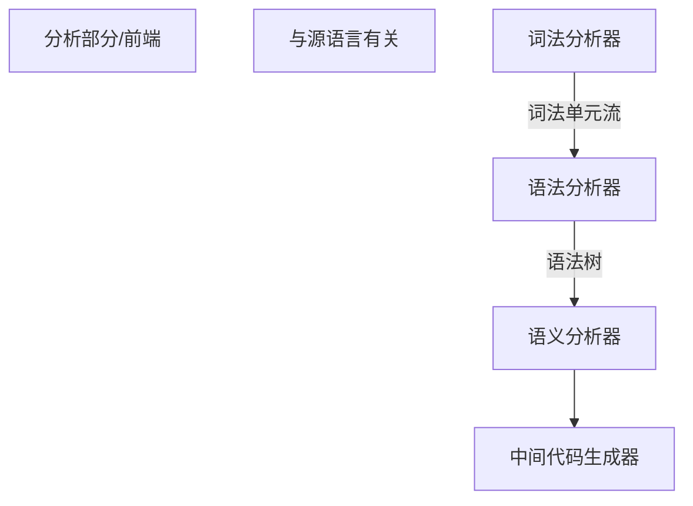

# 编译原理


1. 语义分析 

2. 语法分析
3. 词法分析



```MERMAID
flowchart TD
R[综合部分/后端]
T[与目标语言有关]
A[目标代码生成器]--目标机器语言-->B[及其相关代码优化器]-->C[目标机器语言]
```


## 词法分析/扫描(scanning)


1. 主要任务:从左到右扫描源程序,识别单词,确定类型,转化为词法单元(token)的格式

**token: <种别码,属性值>**


IDN 表示标识符


## 语法分析(parsing)

1. 主要任务:
   从词法分析的token序列中识别各类短语,构造语法分析树(parse tree)


